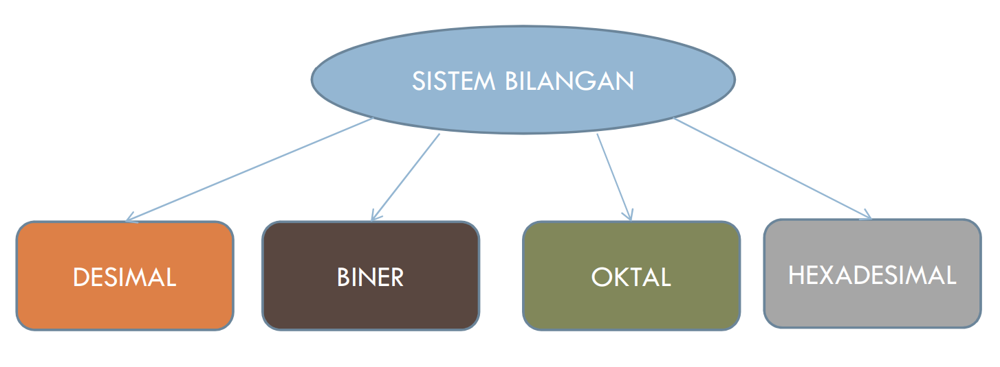
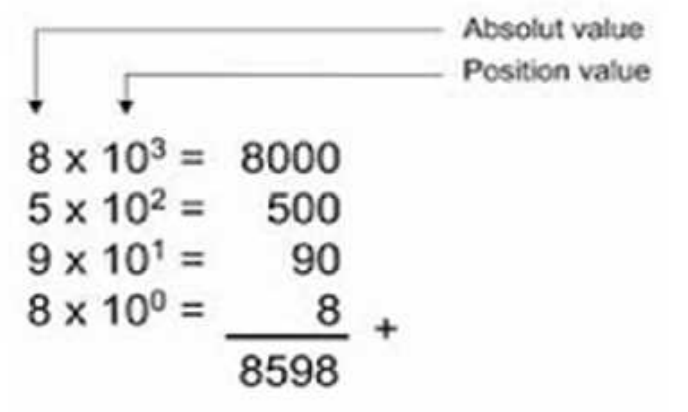
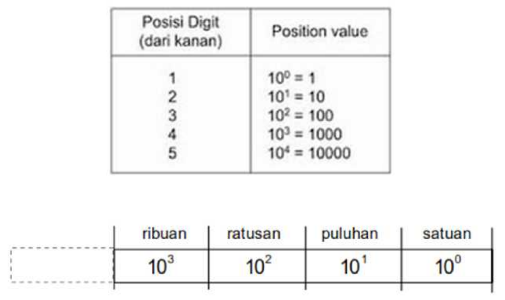
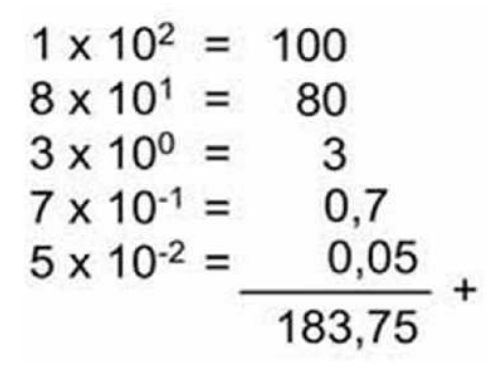

# Sistem Bilangan
## Pengertian
- **Sistem bilangan** atau Number System adalah suatu cara untuk mewakili besaran dari suatu item fisik
- Sistem bilangan menggunakan suatu bilangan dasar atau basis (base / radix) yang tertentu

## Jenis Sistem Bilangan


- Sistem bilangan biner (binary)
- Sistem bilangan desimal (decimal)
- Sistem bilangan oktal (octal)
- Sistem bilangan heksadesimal (hexadecimal)

## Desimal (Basis 10)
- **Desimal (Basis 10)** adalah Sistem bilangan yang paling umum digunakan dalam kehidupan sehari-hari.
- Sistem bilangan desimal menggunakan basis 10 dan menggunakan 10 macam simbol bilangan yaitu: 0, 1, 2, 3, 4, 5, 6, 7, 8, dan 9.
- Untuk melihat nilai bilangan desimal dapa digunakan perhitungan seperti berikut, misalkan contoh bilangan desimal adalah 8598. Ini dapa diartikan:


- dengan begitu maka bilangan desimal 8598 bisa diartikan sebagai berikut:
```
8598₁₀ = (8 x 1000) + (5 x 100) + (9 x 10) + (8 x 1)
```
- Sistem bilangan desimal juga bisa berupa pecahan desimal (decimal fraction), misalhnya : 183,75 yang dapat diartikan:
